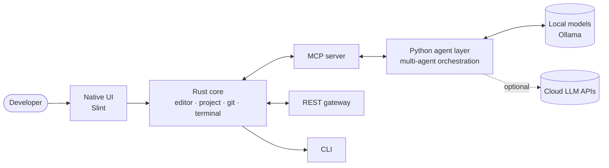

<p align="center">
  
</p>

<p align="center">
  
</p>

<p align="center">
  <a href="https://www.linkedin.com/in/guillaume-piron-1a657a3b"></a>
  <a href="https://crates.io/users/guillaume-piron-dev"></a>
  <a href="https://www.deviantart.com/pipayofficial"></a>
  <a href="mailto:untelec.pro@gmail.com"></a>
</p>

---

## 👋 About me

I'm a **software developer and designer based in Montpellier, France**, and the founder of **[Untelec](https://github.com/Untelec)**, an independent software studio.

I build **complete products, alone, from the first sketch to the signed installer**: system architecture, Rust core, Python AI tooling, native user interfaces, automated tests, documentation, packaging and licensing. Six years as a freelance web developer and UI/UX designer taught me to think about the person using the software first; the last years in Rust taught me to make that software fast, safe and predictable.

What drives my work:

- 🦀 **Native over heavy** — compiled Rust and native UI instead of browser shells
- 🔒 **Local-first and private by design** — your code and your data stay on your machine
- 🤖 **AI as a tool, not a gimmick** — agents that are inspectable, local and under the user's control
- ⚖️ **Digital rights** — software that helps people and companies respect privacy law, not dodge it

<table>
<tr>
<td valign="top" width="50%">

**🔭 Right now**
- Shipping **ForgeNova** (installers for Windows, macOS, Linux)
- Building **My Safe Place** (Rust / Axum + TypeScript)
- Private R&D on AI safety and scientific simulation

</td>
<td valign="top" width="50%">

**🤝 Open to**
- Rust / Python developer roles — remote or Montpellier area
- Freelance missions: desktop apps, dev tools, AI integration, privacy compliance
- Collaboration on open-source developer tooling

</td>
</tr>
</table>

---

## 🧰 Tech stack

<p align="center">
  <br/>
  
</p>

<p align="center">
  
  
  
  
  
  
  
  
</p>

<details>
<summary><b>Detailed toolbox</b></summary>

| Domain | What I use |
|---|---|
| **Systems & desktop** | Rust (Tokio, Serde, Clap, Reqwest), Slint, cross-compilation, Windows / macOS / Linux packaging |
| **AI engineering** | Multi-agent orchestration in Python, MCP servers, local inference with Ollama, RAG, prompt engineering, Anthropic & OpenAI APIs |
| **Web** | React, Next.js, TypeScript, Vite, FastAPI, Flask, Axum, REST, GraphQL |
| **Mobile** | Flutter (iOS / Android) |
| **Data** | PostgreSQL, SQLite, Redis, MongoDB |
| **Infrastructure** | Linux & Windows Server administration, virtualisation, network security, Docker, GitHub Actions CI/CD, Azure |
| **Security & privacy** | GDPR / CCPA compliance, RFC 6265 cookie analysis, secrets hygiene, signed commits, zero-trust workstation hardening |
| **Design** | UI/UX, design systems, Figma, CorelDRAW, visual identity, responsive web |
| **Methods** | Clean Architecture, TDD, Agile / Scrum, exhaustive technical documentation |

<!-- TODO : si tu utilises encore des outils de l'ancien README (Kubernetes, Terraform, Ansible, Jenkins, GitLab CI, AWS, GCP, Cisco, Prometheus, Grafana, ELK), ajoute-les à la ligne Infrastructure. -->

</details>

---

## 🚀 Flagship — ForgeNova

> **A native, AI-assisted IDE written in Rust and Slint.** No Electron, no WebView, no Monaco: the editor, the UI and the agent runtime are compiled to native code, and AI runs locally.

<!-- TODO (au lancement) : capture d'écran ou GIF de 10 s de l'IDE, ex.
<p align="center"></p>
-->

<table>
<tr>
<td align="center"><b>940+</b><br/><sub>Rust source files</sub></td>
<td align="center"><b>120+</b><br/><sub>Python agent modules</sub></td>
<td align="center"><b>72</b><br/><sub>Slint UI files</sub></td>
<td align="center"><b>1,128</b><br/><sub>automated tests passing</sub></td>
<td align="center"><b>5</b><br/><sub>compiled binaries</sub></td>
<td align="center"><b>3</b><br/><sub>platforms (Win · macOS · Linux)</sub></td>
</tr>
</table>



**Design choices**
- **Custom native text editor** in Slint instead of an embedded web editor — zero runtime web dependencies
- **Agents exposed through MCP**, so the same tools are usable from the IDE, the CLI and external clients
- **Local-first inference**: source code never has to leave the machine
- **Zero compiler warnings policy** and a test suite that runs on every build
- Distribution through signed installers and licensed editions (Community / Pro / Enterprise)

<sub>Source code is proprietary and owned by Untelec.</sub>
<!-- TODO : lien vers le repo vitrine public / releases, ex. https://github.com/Untelec/forgenova -->

---

## 🍪 ICookForms — cookie audit & privacy compliance

[](https://crates.io/crates/icookforms)
[](https://docs.rs/icookforms)
[](https://github.com/guillaume-piron-dev/ICookForms/blob/main/LICENSE)


A Rust CLI **and** library to audit the cookies a website sets and check them against security best practices and privacy law.

| Module | What it does |
|---|---|
| `scanner` | HTTP client + multi-page crawler, extracts cookies from headers and pages |
| `parser` | RFC 6265 / 6265bis attribute parsing and validation |
| `analyzer` | Flags missing `Secure` / `HttpOnly` / `SameSite`, session-hijacking and CSRF exposure |
| `compliance` | GDPR, CCPA/CPRA and LGPD checks, consent analysis |
| `forensics` | Timeline reconstruction, iOS `.binarycookies` parsing, Google Analytics cookie decoding, evidence hashing |
| `ml_analyzer` | Isolation-Forest anomaly detection on cookie behaviour |
| `reporter` | HTML, PDF, JSON, CSV and YAML reports |

```bash
cargo install icookforms
icookforms scan --url https://example.com --output cookies.json --format json
icookforms compliance gdpr --input cookies.json
icookforms report --input cookies.json --format html --output report.html
```

```rust
use icookforms::{Scanner, Analyzer};
use icookforms::types::config::ScanConfig;

let result = Scanner::new(ScanConfig::default())?.scan("https://example.com").await?;
let analysis = Analyzer::new().analyze(&result.cookies)?;
println!("{} cookies · {} security issues", result.cookies.len(), analysis.security_issues.len());
```

→ **[Repository](https://github.com/guillaume-piron-dev/ICookForms)** · **[Documentation](https://docs.rs/icookforms)**

---

## 🛡️ My Safe Place — digital-rights protection *(in development)*

A platform that helps individuals **exercise their right to be forgotten and their image rights online**: find where personal content appears, document it, and generate the right requests.

- **Backend**: Rust + Axum · **Frontend**: TypeScript SPA (Vite)
- **Interface in every official EU language + English**, switchable by the user
- Built with the legal groundwork done upfront (GDPR, image rights)
- To be released under **Apache-2.0** by Untelec

---

## 🧪 Private R&D

Alongside my products, I run a private research lab exploring AI safety, multimodal pipelines, scientific simulation and secure communication. The code stays private; **demos and technical walkthroughs are available on request.**

| Area | What I explore | Stack |
|---|---|---|
| 🧠 **AI behaviour & safety** | Diagnosing AI systems: behavioural monitoring, detection and isolation of unsafe model outputs, multi-model connectors | Python |
| 🔀 **Multimodal AI pipelines** | Sequential and asynchronous orchestration across text, image and audio | Python, async |
| 🧬 **Scientific simulation** | Structural modelling and interactive 3D visualisation of biomedical scenarios | Python, Next.js, React |
| 🔐 **Secure communication** | Serverless peer-to-peer messaging with end-to-end encryption | Flutter, cryptography |

<!-- TODO : si Kirébos Networks est toujours actif, l'ajouter ici. -->

---

## ✅ How I work

- **Tests first-class** — large automated suites, `clippy` clean, warnings treated as errors
- **Security hygiene** — no secrets in repositories, signed commits, hardened dev workstation, private-by-default for unreleased code
- **Documentation as a deliverable** — architecture docs, compliance checklists, changelogs, bilingual READMEs (FR / EN)
- **Product thinking** — licensing, pricing, packaging, legal protection of IP: I ship software people can actually install and buy

---

## 🗺️ Journey

```text
2017 ──── Freelance web developer & UI/UX designer
          visual identities, responsive websites, CMS, SEO for small businesses
2020 ──── BTS Graphiste Web-Designer (16/20)
2023 ──── Systems & network administration training (YYYOURS)
          Linux, Windows Server, virtualisation, network security
2024 ──── Switch to systems programming: Rust, Python, AI integration
          EPSI Montpellier — software development · Python certification
2025 ──── Founded Untelec · published ICookForms on crates.io
2026 ──── ForgeNova completed — native AI IDE, installers for 3 platforms
          My Safe Place relaunched
```

---

## 🎨 Beyond code

- **Graphic & UI design** — visual identities, interfaces and illustration → [portfolio](https://www.deviantart.com/pipayofficial)
- **Music production** — a catalogue of ~800 instrumental tracks registered with SACEM, produced in FL Studio, now exploring AI-assisted vocal production
- **Photography**, and a long-standing interest in **AI research, neuroscience and health innovation**

🗣️ French (native) · English (B2/C1) · Spanish (B1)

---

<details>
<summary><b>🇫🇷 Version française</b></summary>

### À propos

Développeur et designer basé à **Montpellier**, fondateur d'**Untelec**, studio logiciel indépendant. Je conçois des produits complets, seul, de la première maquette à l'installeur signé : architecture, cœur en Rust, outillage IA en Python, interfaces natives, tests, documentation, distribution et licences.

### Projets

- **ForgeNova** — IDE natif assisté par IA, en Rust et Slint, sans Electron ni WebView. 940+ fichiers Rust, 1 128 tests automatisés, 5 binaires, installeurs Windows / macOS / Linux, agents IA locaux via MCP et Ollama.
- **ICookForms** — outil Rust (CLI + bibliothèque) d'audit de cookies et de conformité RGPD / CCPA / LGPD, publié sur crates.io.
- **My Safe Place** — plateforme d'aide à l'exercice du droit à l'oubli et du droit à l'image, interface dans toutes les langues officielles de l'UE. En développement.
- **R&D privée** — sécurité et comportement des IA, pipelines IA multimodaux, simulation scientifique, communication chiffrée. Démonstrations sur demande.

### Ouvert à

Postes de développeur Rust / Python (télétravail ou région de Montpellier), missions freelance (applications desktop, outils développeur, intégration IA, conformité vie privée), collaborations open source.

📫 untelec.pro@gmail.com

</details>

<p align="center">
  
</p>
